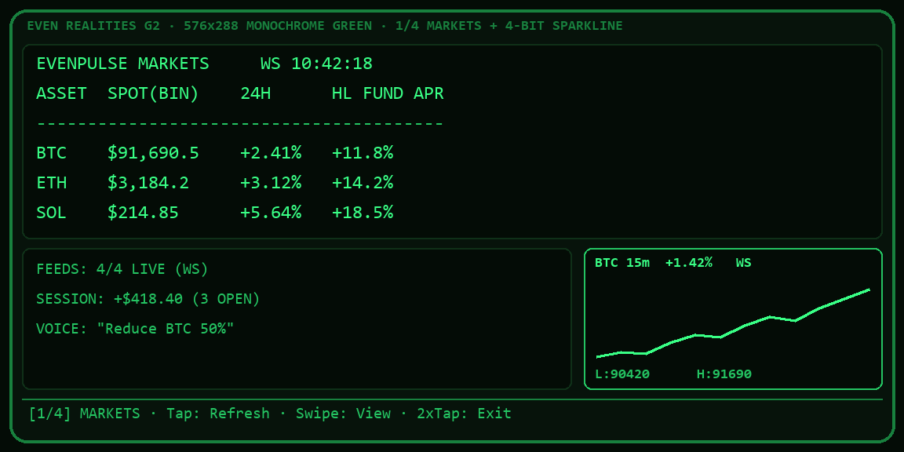

# EvenPulse v2.0 — Live 4-Venue Markets, 4-Bit Micro-LED Sparklines & Voice-Gated HUD for Even Realities G2

**Tracks:** `03 · Exchanges & Stocks` + `02 · Crypto & DeFi` *(Heads Up: Even Realities Hackathon)*

EvenPulse turns **Even Realities G2** smart glasses (`576 × 288` monochrome-green waveguide display) into a zero-friction, **read-and-write** trading & risk-monitoring cockpit powered by **4 live public exchange venues** (**Binance**, **OKX**, **Coinbase**, **Hyperliquid**) — with **4-bit micro-LED sparklines & spread bars (`updateImageRawData`)**, **push-to-talk voice intent commands (`audioControl`)**, **Default-NO 30-second expiring safety gates**, **zero API keys**, and **zero custody**.



---

## Problem & Target User

Active crypto, spot, and perpetuals traders constantly pull out their phone during meetings, commutes, or away-from-desk sessions just to check:
1. Sub-second spot/perp prices & Hyperliquid annualized funding rates across venues,
2. Whether **cross-exchange spreads (`Coinbase / OKX / Hyperliquid vs Binance`)** are widening,
3. Current **session PnL** and **liquidation distance %**,
4. How to **act quickly and safely** (trim 50%, take profit, or arm a price/spread alert) without unlocking a phone or risking an accidental temple tap.

---

## What's New in v2.0 (Built for Every G2 Rubric Criterion)

| Pillar | What EvenPulse v2.0 Ships |
|---|---|
| **4-Venue Live Feeds + WebSocket** | Live **Binance** (WebSocket `miniTicker` + 15m Klines), **OKX** (Spot), **Coinbase** (USD Spot), and **Hyperliquid** (`metaAndAssetCtxs` mark & annualized funding APR) — 100% public, CORS-enabled, zero keys |
| **4-Bit Micro-LED Graphics (`updateImageRawData`)** | Dedicated `200 × 96` `ImageContainerProperty` rendering live 15m BTC sparklines, liquidation safety gauges, 4-venue spread bar charts, 16kHz PCM voice waveforms, and safety-gate countdown bars directly on G2 |
| **Voice PTT + Local Intent Engine (`audioControl`)** | Natural short phrases (*"Reduce BTC 50%"*, *"Close ETH"*, *"Alert BTC above 95000"*, *"Alert spread above 10 bps"*, *"Show spreads"*) parsed 100% locally with zero external LLM keys; live 16kHz PCM energy visualizer on G2 |
| **Default-NO 30s Safety Gates (Write Safety)** | Every state-changing paper action (`Reduce 50%`, `Close 100%`, `Open Paper`, `Arm Alert`) opens a **Default-NO** overlay (`[NO] Cancel` highlighted by default; swipe to arm `[YES]`, tap to confirm; auto-cancels in 30s) + immutable session Audit Log |
| **4-Container Non-Overlapping G2 Layout** | `hud` (`576×142` text) + `status` (`366×96` text) + `chart` (`200×96` 4-bit image) + `footer` (`576×36` text) with serialized SDK writes and protobuf-zero-safe `eventTypeOf()` routing |

---

## 4 Glanceable G2 Views + Safety Gate Overlay

| View | Top HUD (`576×142`) | Bottom-Right 4-Bit Graphic (`200×96`) | Gesture |
|---|---|---|---|
| **1/4 · MARKETS** | Live Binance spot (WS), 24h %, Hyperliquid funding APR (`BTC/ETH/SOL/BNB`) | Live **15m BTC Sparkline** (`WS/REST` + High/Low bounds) | Tap: Refresh · Swipe: Next view |
| **2/4 · POSITIONS** | Session PnL, open paper positions, unrealized PnL & Liq Distance % | Per-position **Liquidation Safety Gauges** | Swipe Up/Down: Switch views |
| **3/4 · SPREADS** | Binance vs Coinbase/OKX/Hyperliquid real-time spread (`bps`) | **4-Venue Diverging Spread Bar Chart** | Swipe Up/Down: Switch views |
| **4/4 · ALERTS** | Armed & triggered price / spread alerts | **Alert Radar & Audit Log Counter** | Tap: Cycle · Voice: Arm new alert |
| **SAFETY GATE** | `[!] SAFETY GATE (30s) · DEFAULT-NO` action summary | **30s Countdown Bar + `[NO]` / `[YES]` Selector** | Swipe: Toggle `NO/YES` · Tap: Confirm |

- **Universal Exit**: Double-tap at any time calls `bridge.shutDownPageContainer(1)` cleanly.

---

## Live Exchange Endpoints (Public, Read-Only, Zero Keys)

| Venue | Endpoint | Data |
|---|---|---|
| **Binance WebSocket** | `wss://data-stream.binance.vision/stream` | Sub-second live `miniTicker` stream (`BTC/ETH/SOL/BNB`) |
| **Binance REST** | `https://data-api.binance.vision/api/v3/ticker/24hr` & `/klines` | 24h spot snapshot + 15m candle series for 4-bit sparklines |
| **OKX** | `https://www.okx.com/api/v5/market/ticker` | Live USDT spot prices across `BTC/ETH/SOL/BNB` |
| **Coinbase** | `https://api.exchange.coinbase.com/products/{PAIR}/stats` | Live USD spot prices for Coinbase–Binance premium (`bps`) |
| **Hyperliquid** | `https://api.hyperliquid.xyz/info` (`metaAndAssetCtxs`) | Live perp mark prices & hourly funding (annualized APR) |

---

## Quick Start (Official Even Hub Simulator & Standalone AR Preview)

### Prerequisites
- Node.js v18+

### Run Locally in the Even Hub Simulator
```bash
git clone https://github.com/teylerboal-dev/evenpulse-g2.git
cd evenpulse-g2
npm install
npm run dev
```
In a second terminal, launch the official Even Hub desktop simulator:
```bash
npm run simulate
# (runs: evenhub-simulator http://localhost:5173)
```
Or visit the **Live Demo** (`https://teylerboal-dev.github.io/evenpulse-g2/`) in any browser to test the interactive **`576 × 288` G2 Lens Mirror + Optical AR Overlay**, **4-Bit Micro-LED Canvas**, **Voice Intent Engine**, **Default-NO Safety Gates**, and keyboard controls (`↑/↓` swipe, `Enter/Space` tap, `Esc` exit).

### Build, Test & Package `.ehpk`
```bash
npm test        # Runs unit tests (voice intents, Default-NO safety gate, spread & liq math)
npm run build   # TypeScript typecheck + Vite production bundle
npm run pack    # Packages app.json + dist/ into evenpulse-g2.ehpk
```

---

## Even Hub SDK API Feature Requests (Optional Feedback)

1. **Native 4-bit grayscale vector/sparkline primitive** (e.g., `LineChartContainerProperty`) so real-time market sparklines update over BLE at 1Hz without re-encoding full PNG frames.
2. **Built-in on-device wake-word / short-command STT hook** alongside `audioControl()` so G2 apps can confirm short trading phrases (`"yes"`, `"cancel"`, `"reduce half"`) with sub-300ms latency.
3. **Standardized modal/toast confirmation container** with hardware-enforced Default-NO semantics for financial/destructive write confirmations.
4. **Native haptic / subtle audio chime trigger** on `TextContainerUpgrade` when a high-priority price or liquidation alert fires.
5. **Simulator keyboard-to-R1-ring mapping flag** in `evenhub-simulator` CLI for automated end-to-end UI testing in CI.

---

## Pre-Existing Libraries & Code Disclosure

All application source code (`src/exchanges.ts`, `src/paper.ts`, `src/voice.ts`, `src/g2-graphics.ts`, `src/g2-renderer.ts`, `src/main.ts`, `index.html`, `app.json`, `tests/evenpulse.test.mjs`) was written fresh during the hackathon (Nov 26–27, 2026). Pre-existing open-source dependencies used:
- `@evenrealities/even_hub_sdk`, `@evenrealities/evenhub-cli`, `@evenrealities/evenhub-simulator` (official Even Realities SDK & tooling; protobuf-zero-safe `eventTypeOf` pattern adapted from `even-realities/evenhub-templates` MIT template)
- `vite`, `typescript`

## License
MIT
